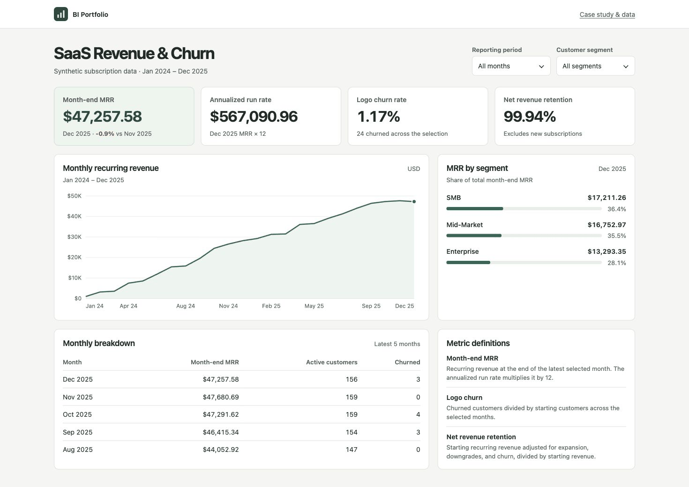
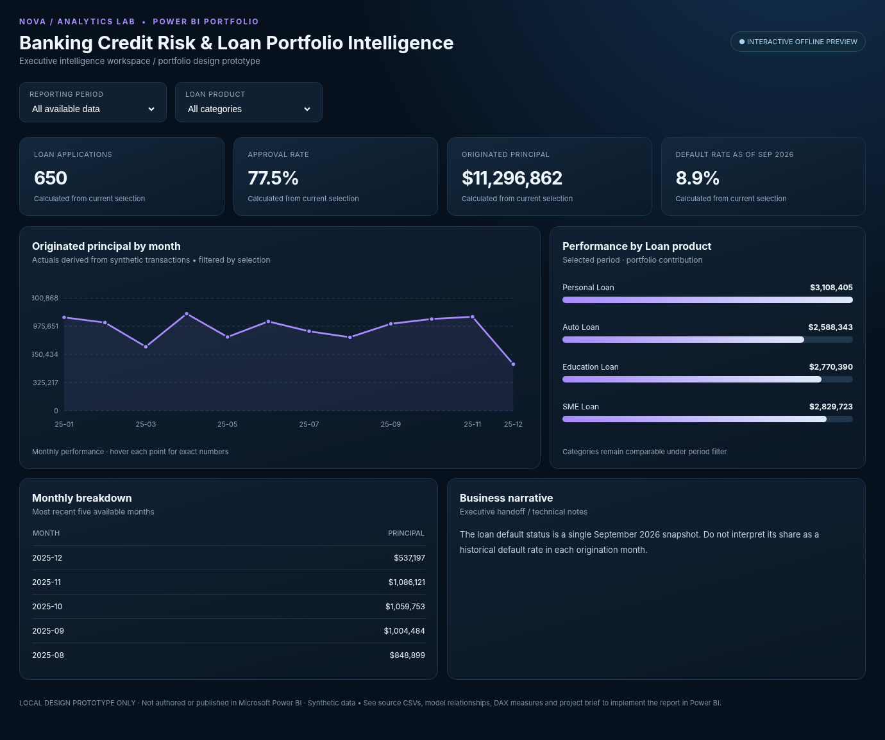
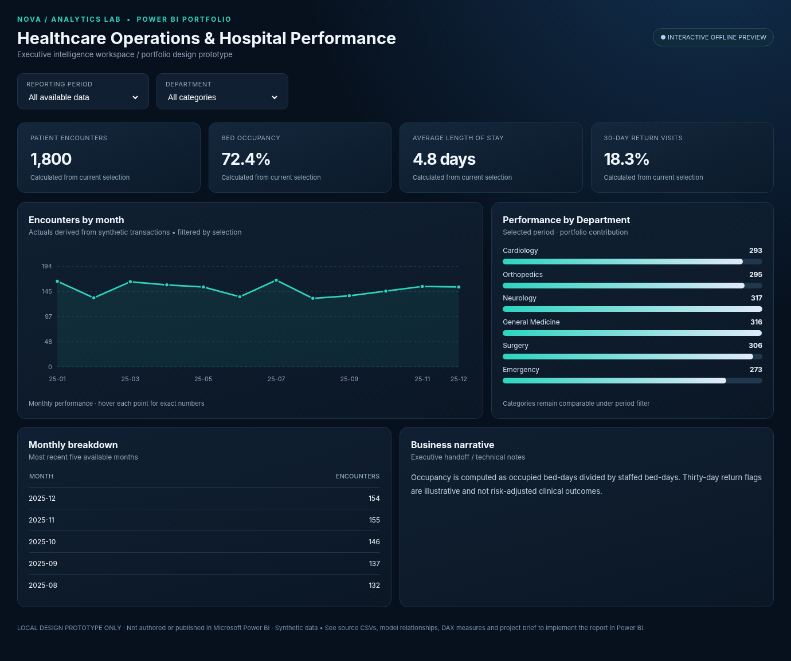
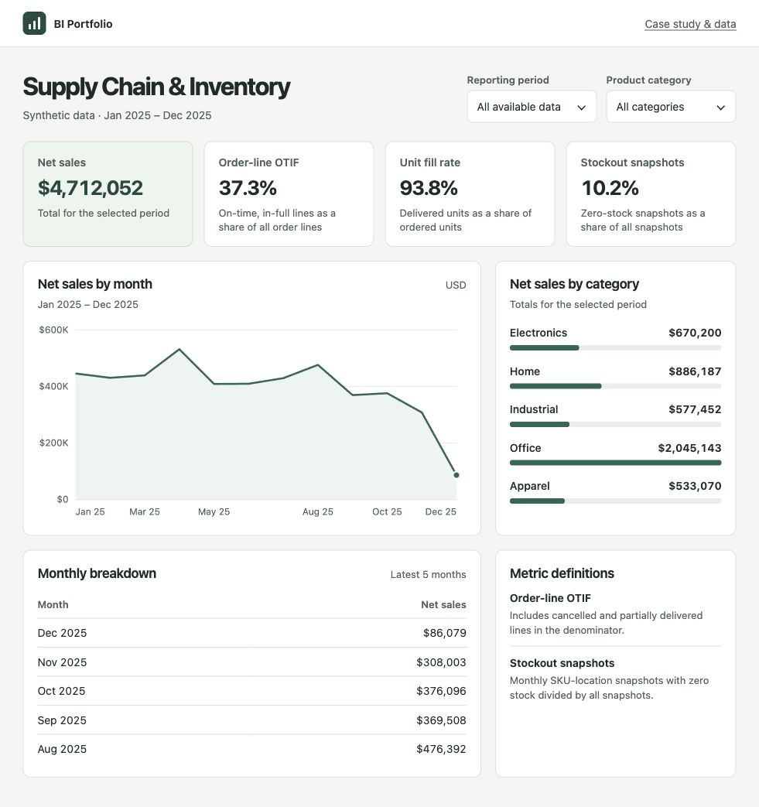

# Power BI Industry Analytics Portfolio

**Four original business intelligence case studies · 24 structured data tables · 28,069 synthetic source rows**

> **Build status:** Datasets, data-quality checks, DAX measure drafts, data dictionaries, three-page Power BI report blueprints, PDF briefs, and working standalone HTML previews are included. The SaaS case study also includes an editable [Power BI project](SaaS_Revenue_Churn_Intelligence/power-bi/) and [KPI reconciliation](SaaS_Revenue_Churn_Intelligence/#kpi-reconciliation).

Inspired by the presentation approach of [sachinkumar1609/PowerBI-Project](https://github.com/sachinkumar1609/PowerBI-Project). No data or dashboards were copied from that repository.

## Explore the projects

| Project | Dashboard preview | Data model | Business focus |
|---|---|---|---|
| [SaaS Revenue & Churn](SaaS_Revenue_Churn_Intelligence/) | [Open dashboard](https://sumitgole011.github.io/PowerBI-Industry-Analytics-Portfolio/SaaS_Revenue_Churn_Intelligence/dashboard_preview.html) | 5 tables | MRR, ARR, retention, subscription expansion |
| [Banking Credit Risk](Banking_Credit_Risk_Intelligence/) | [Open HTML](Banking_Credit_Risk_Intelligence/dashboard_preview.html) | 6 tables | Loan approvals, default, collections |
| [Healthcare Operations](Healthcare_Operations_Intelligence/) | [Open HTML](Healthcare_Operations_Intelligence/dashboard_preview.html) | 6 tables | Patient flow, length of stay, bed occupancy |
| [Supply Chain & Inventory](Supply_Chain_Inventory_Intelligence/) | [Open HTML](Supply_Chain_Inventory_Intelligence/dashboard_preview.html) | 7 tables | OTIF, order fill rate, inventory health |

## Dashboard gallery

[](https://sumitgole011.github.io/PowerBI-Industry-Analytics-Portfolio/SaaS_Revenue_Churn_Intelligence/dashboard_preview.html)

| Banking | Healthcare | Supply Chain |
|---|---|---|
|  |  |  |

## Tech stack and what's currently included

- **Sources:** deterministic Python-generated, synthetic CSV files (`data/*.csv`)
- **Database server:** none yet; PostgreSQL integration would be an *optional future upgrade*
- **BI pipeline:** planned Power Query transformations, star-schema relationships, DAX measure drafts, Power BI report blueprints
- **Working preview:** standalone HTML + CSS + JavaScript (`dashboard_preview.html`) with local filters; no backend required
- **Quality assurance:** `validate_all.py` checks keys, integrity, row grain, and KPI reconciliations
- **Docs:** data dictionaries, interview guide, PDF business brief, metadata, and multi-page design specs for each project

## Getting started on a Mac

1. Pick one project, e.g. [`SaaS_Revenue_Churn_Intelligence`](SaaS_Revenue_Churn_Intelligence/).
2. Open its `dashboard_preview.html` file in a browser to inspect the prototype.
3. Open [Power BI Service](https://app.powerbi.com/), import `POWERBI_SERVICE_STARTER.csv` if your workspace provides the CSV semantic-model import flow, and verify types.
4. Use the project's `service_starter_measures.dax` to create single-table metrics and follow `dashboard_blueprint.md` to construct the actual Power BI report.
5. For the complete star schema, import the source tables in **Power BI Desktop on Windows**, follow `relationships.md`, and implement the measures from `measures.dax`.
6. Validate results against `metrics.json` and capture new screenshots only after confirming accuracy.

## Data QA

```bash
python3 validate_all.py
```

Expected: `PASS: unique keys, foreign keys, reconciliation, grain and range tests`

To regenerate data, first back up the existing files. Some scripts overwrite generated outputs. See [DEVELOPMENT.md](DEVELOPMENT.md).

## Optional public HTML demo (GitHub Pages)

The static demo is staged under [`docs/`](docs/). After pushing, open **Repository Settings → Pages → Build and deployment → Deploy from a branch → main → /docs → Save**. GitHub Pages then serves the four independent previews at your account's GitHub Pages URL. Pages is *not* automatically enabled by this repository package.

## Detailed project resources

Each folder includes `README.md`, `data_dictionary.md`, `schema.json`, `relationships.md`, `measures.dax`, `service_starter_measures.dax`, `dashboard_blueprint.md`, `metrics.json`, `INTERVIEW_GUIDE.md`, `project_brief.pdf`, and dashboard preview files. [Master portfolio guide](PORTFOLIO_MASTER_GUIDE.pdf) provides a high-level overview.

## Scope and attribution

Every dataset is **fictional**. This material must not be used to make financial, clinical, or credit decisions. Source HTML previews are concept demonstrations; they are not screenshots or live embeddings of actual Power BI Desktop reports. Desktop verification and `.pbix` export for the SaaS project remain open.
